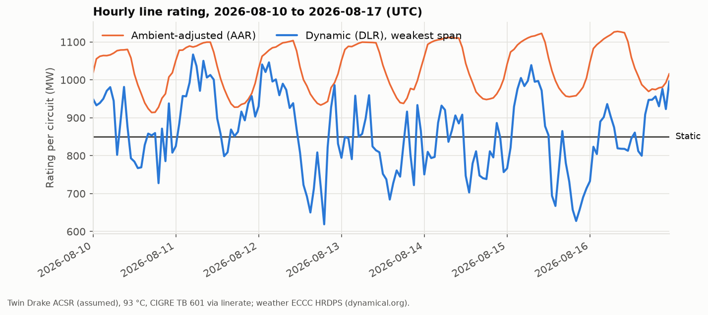
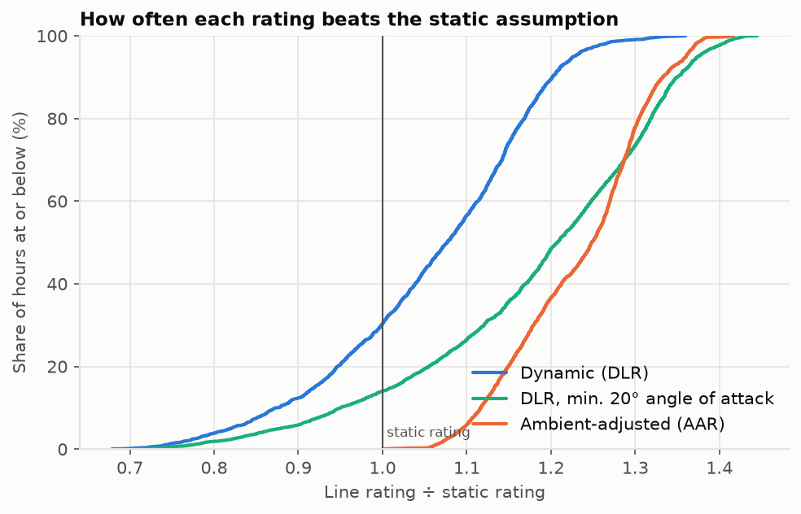
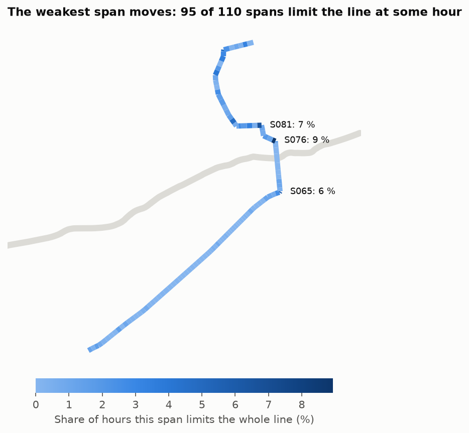
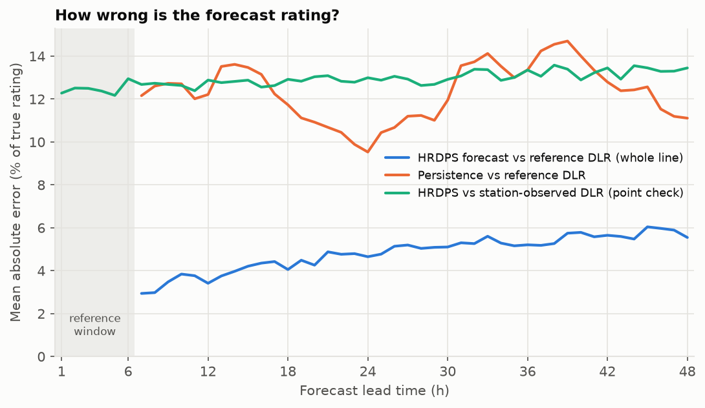
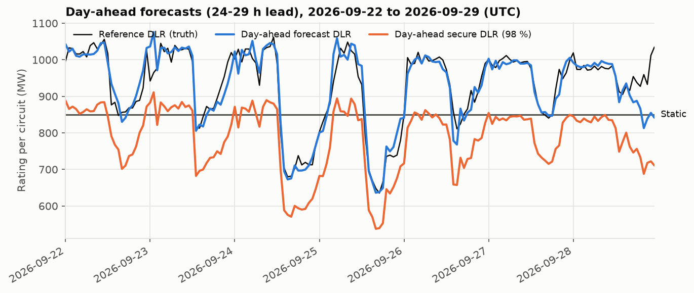
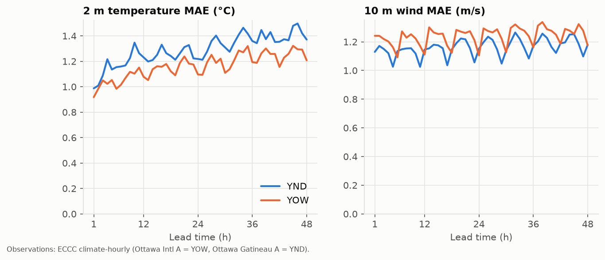
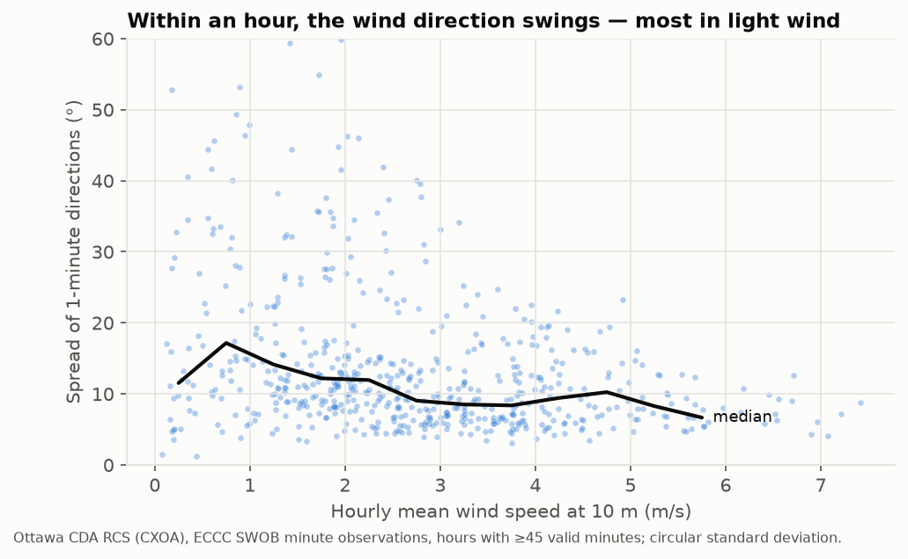
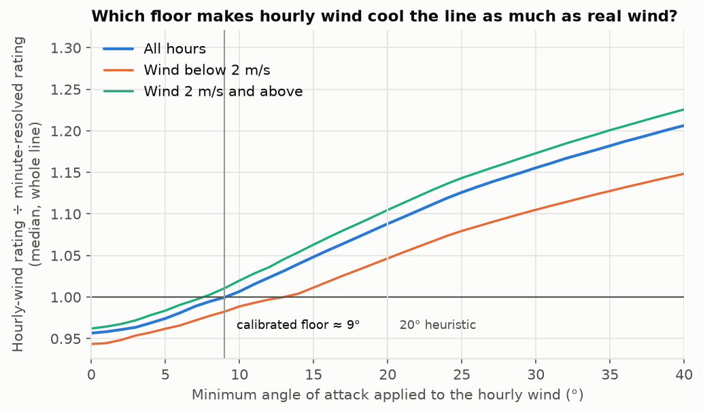

# Results

> **Snapshot: 2026-07-09 → 2026-10-14** (2,340 hours, summer to early fall),
> assumed twin-*Drake* conductor. The pipeline recomputes everything with
> every new weather run, so the live dashboard and
> `data/processed/*summary.json` will drift from these figures. Method in
> [METHODOLOGY.md](METHODOLOGY.md).

## Headlines

- **Static rating:** about **850 MW per circuit** in summer (2,134 A) and
  1,081 MW in winter (2,715 A).
- **The weather-based rating is a median +8 % above static.** It is above
  static 70 % of the time, and more than 20 % above it 10 % of the time.
- **The static rating is optimistic in 30 % of hours.** The line turns, so in
  almost any wind some span faces it edge-on. **95 of the 110 spans** are the
  weakest at some hour.
- **Wind direction within the hour matters.** Minute observations show the
  direction swinging enough to cool the line like a **≈9° minimum angle to the
  wire**. With that, the median gain is **+12 %**.
- **Forecasts hold up:**
  - the error is 3 % at 7 h ahead and 5.6 % at 48 h;
  - the 98 % secure rating was above the true rating in **1 %** of
    out-of-sample hours, against **19 %** for the static rating.

## Ratings

| | Value |
|---|---|
| Dynamic ÷ static, median (p5 / p95) | **1.08** (0.82 / 1.23) |
| Ambient-adjusted ÷ static, median | 1.25 |
| Hours with dynamic below static | **30.3 %** |
| …of which mainly due to wind angle / wind speed / air temperature | 91 % / 7 % / 2 % |
| Ambient-adjusted rating above the dynamic one | 98.9 % of hours |
| Spans that are the bottleneck at some hour | 95 of 110 (S076 9 %, S081 7 %, S065 6 %) |
| Worst hour | 2026-08-06 16:00 UTC: 577 MW per circuit (0.68 × static) |
| Best hour | 2026-10-06 12:00 UTC: 1,156 MW per circuit (1.36 × static) |

**Why the gain is modest, and why static is sometimes unsafe.** The static
rule assumes a gentle 4 km/h wind hitting **every span at a right angle**. On
a line whose spans point in every direction, at almost any hour some span has
the wind running along it. A 2.8 m/s wind along a wire cools it less than
1.1 m/s across it. The ambient-adjusted rating keeps the same optimistic wind,
so it sits above the physics almost all the time.

### Sensitivities

| Variant | Static line rating | Dynamic ÷ static, median | Hours below static |
|---|---|---|---|
| **Base** (twin Drake, 93 °C, exact wind direction) | 2,134 A | 1.08 | 30.3 % |
| Conductor one size down (twin Grosbeak) | 1,865 A | 1.07 | 31.7 % |
| Conductor one size up (twin Cardinal) | 2,310 A | 1.08 | 29.7 % |
| Maximum temperature 75 °C | 1,683 A | 1.20 | 16.2 % |
| Maximum temperature 127 °C (emergency) | 2,740 A | 0.99 | 52.2 % |
| **Attack-angle floor 9°** (measured, see below) | 2,134 A | **1.12** | **22.5 %** |
| Attack-angle floor 20° (heuristic) | 2,134 A | 1.21 | 14.0 % |
| Without terrain sheltering | 2,134 A | 1.10 | 26.7 % |

- **Conductor size barely changes the ratio.** Results stated relative to
  static are robust to the unknown conductor.
- **Wind-direction handling is the biggest modelling choice.** The plausible
  range is +8 % (exact hourly direction) to +12 % (measured 9° floor).

### N-1 context (illustrative)

With both circuits in service, the 1,250 MW converter limits the tie. If one
circuit trips, the other must carry the flow within its 127 °C emergency
rating.

| | Single-circuit emergency rating | Hours when the tie's flow exceeded it |
|---|---|---|
| Static | 1,092 MW | 55 % |
| Dynamic | median 1,089 MW, varies hourly | 53 % |

The tie's median flow was 1,165 MW. The dynamic rating would cover an extra
5 % of hours. With the *assumed* conductor, one circuit couldn't carry typical
flows even at emergency temperature. So either the real conductor is larger,
or the converter is run back after a contingency; public data can't say which.

## Forecast skill and the secure rating

Backtest: margins fitted on July–August, scored on runs from 1 September
onward (leads ≥ 7 h, 7,140 forecast hours).

| Lead | Rating error (MAE) | 98 % margin |
|---|---|---|
| 7 h | 2.9 % | 8.8 % |
| 12 h | 3.4 % | 15.0 % |
| 24 h | 4.7 % | 17.4 % |
| 48 h | 5.6 % | 22.0 % |

The forecast is unbiased, and about 2.5× better than assuming the next hours
look like now.

| Test period | Exact direction | 9° floor | 20° floor |
|---|---|---|---|
| Secure rating above the truth | **1.0 %** | 0.9 % | 1.0 % |
| Static rating above the truth | **18.7 %** | 14.7 % | 9.6 % |
| Ambient-adjusted above the truth | 99.6 % | 96.7 % | 46.3 % |
| Secure ÷ static, median (24 h ahead) | 0.95 (0.97) | 0.99 (1.01) | 1.04 (1.06) |
| Hours with secure above static | 27 % | 45 % | 64 % |

The secure rating isn't much higher than static on average. Its value is
**when** it differs: it drops on calm afternoons with the wind along the
line, exactly when static is unsafe, and rises on cool, windy days.

## Checks against real observations

### Airports (hourly, YOW and YND)

| | Leads 1–6 h | Leads 24–48 h |
|---|---|---|
| 2 m temperature bias / MAE | +0.2 / 1.05 °C | +0.3 / 1.30 °C |
| 10 m wind bias / MAE | −0.5 / 1.16 m/s | −0.5 / 1.22 m/s |
| Wind direction MAE (wind > 1.5 m/s) | 25° | 29° |

Airport hourly winds are 2-minute snapshots, which inflates these errors.

### Minute observations (Ottawa CDA RCS, 593 hours, 2026-09-15 → 2026-10-14)

- **Fair wind skill.** Compared against the 60-minute mean:
  - speed bias −0.1 to −0.15 m/s, MAE 0.86–0.90 m/s;
  - direction MAE 15–17°.

  About 10 % of the speed error, and a quarter of the direction error, seen
  against snapshots is sampling noise.
- **Light wind is over-forecast.** When the observed mean is below 2 m/s,
  HRDPS over-forecasts by **+0.5 to +0.6 m/s**. That is the regime where
  ratings bind.
- **Direction swings within the hour.** The median spread of 1-minute
  directions is 15° below 1 m/s, 11–13° at 1–3 m/s and 8° above 5 m/s.

  
- **Effective cooling.** On a virtual copy of the line at the station,
  cooling averaged minute by minute gives a line rating a median **4.5 %**
  higher than the hourly wind vector does (6 % in light wind).
  - That equals a **9° minimum angle to the wire**: 13° in light wind, 8° above
    2 m/s.
  - If only the weakest 10 minutes of each hour count, it is 0°. So 0–9° is
    the plausible range.

  
- **Margin needed against reality.** For the whole virtual line, forecast vs
  minute-resolved truth at leads ≥ 7 h:
  - MAE 8.3 %;
  - 98 % margin **16 %** (20 % in light wind), close to the model-based
    day-ahead margin.

  A single fixed-orientation span compared with snapshots would suggest 54 %,
  which mostly measures noise.

## Limitations

- **Assumed values:** the conductor, design temperature, emissivity and
  conductor height are typical public values, not Hydro One's.
- **Weather resolution:** a 2.5 km grid cannot see span-scale effects. The
  terrain sheltering index is a heuristic.
- **Coverage:** about three months, summer to early fall, from one
  deterministic model. Winter, when dynamic gains are usually largest, is not
  in the data yet.
- **Truth:** the ratings' truth is model-based. The observation checks use
  stations about 9 km from the line, at 10 m, over four weeks for the minute
  data.
- **Physics:** steady state only, with no conductor thermal inertia.
- **Use:** a demonstrator, not for operations.
